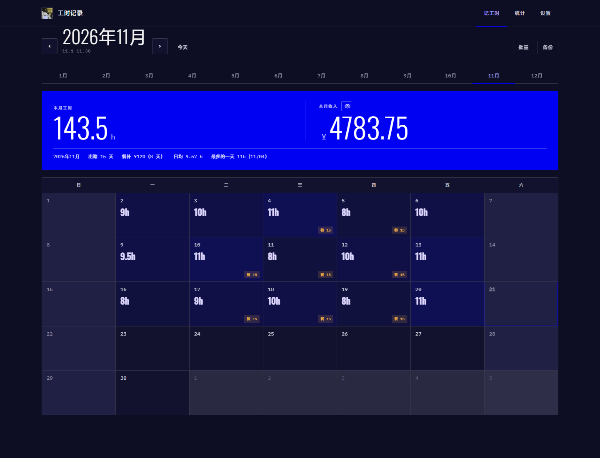
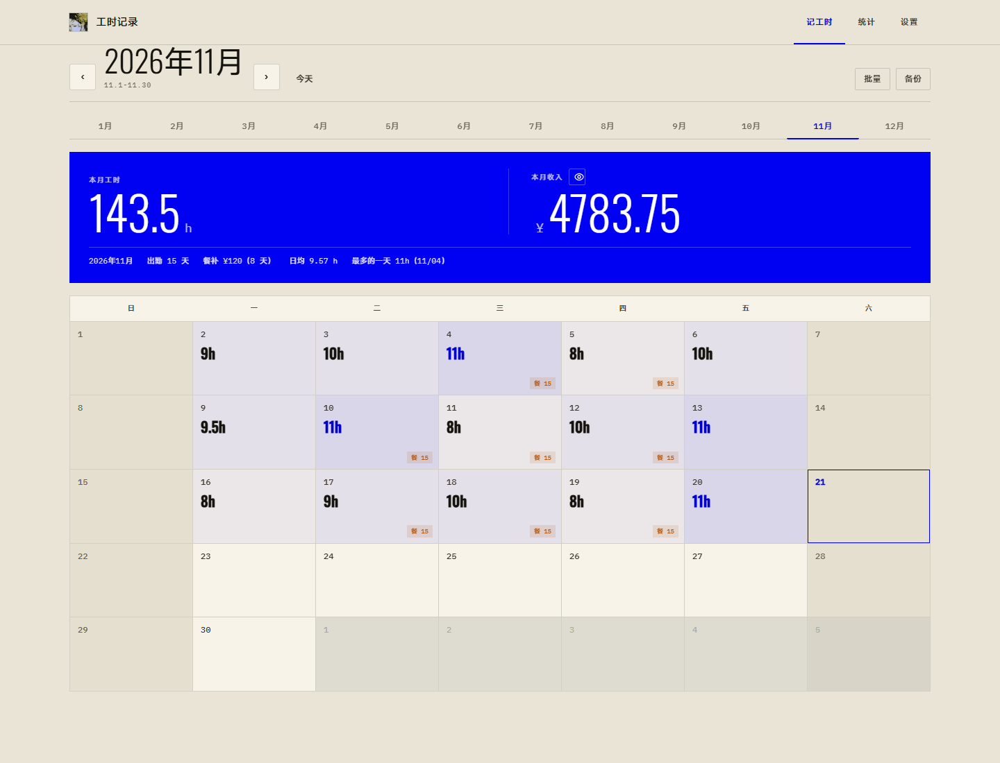

# 工时记录 Worklog

一个**本地优先**的记工时小工具：在日历上记下每天干了几小时，自动按固定时薪算出当天、当月、当年的收入，还能手动标记哪天有餐补、批量把工时铺到一整周。

界面走 **Hermes 深蓝 / 电光蓝**：深蓝底、Oswald 细字、IBM Plex Mono 标签、硬边细线；浅色主题是暖纸底。背景不再用照片和光斑，整个页面只保留轻量的滚动动效。

日历没有照抄原 App 那种黄色方块，而是重新设计了一套**蓝色热力**：工时越多底色越深，餐补用琥珀色小徽标单独标出来。

- 纯静态前端，零运行时依赖（没引任何 UI 库、图表库、日期库）
- 数据默认存在浏览器本地，**不会上传到任何服务器**；可选关联一个本地 JSON 文件自动落盘
- 电脑端设计（1240px 内容宽度、键盘快捷键、悬浮抽屉），手机上也能打开但不作为目标

---

## 预览

| 记工时（深色） | 记工时（浅色） |
| --- | --- |
|  |  |

## 功能

### 记工时
- 月历视图：每格显示当天工时（如 11h）、有餐补的显示金额徽标、今天高亮
- **周末与节假日**：周末用更深的底色，法定节假日标红色标签并写明节日名（元旦 / 春节 / 清明 / 劳动 / 端午 / 中秋 / 国庆），周末调休上班日标灰色「班」；鼠标悬停有完整说明。数据在 src/lib/holidays.ts，按国务院办公厅通知逐年更新
- **单击格子就地输入工时**（回车确认、Esc 取消、点空白处也会保存）；点格子右下角的「⋯」或双击是打开完整抽屉
- 抽屉里可以记多条（上午一个活下午一个活）、单独覆盖时薪、写备注
- 批量模式：**Shift 点选连续区间**、**Ctrl / Cmd + A 全选当月**，也可以按住鼠标拖着刷
- 数字框的调法是**左右拖动**（每 13px 走一格，每格会轻轻弹一下，手感像有卡榫），也可以用右侧的圆形步进键点/按住连续调，或者直接打字、按上下方向键
- 顶部汇总卡：本月工时 / 本月收入（眼睛图标可一键隐藏收入），下面跟着出勤天数、餐补合计、日均工时
- 月份切换：左右箭头、横向月份条、键盘左右方向键，按 T 回到今天

### 餐补
- 按天记，金额范围 **1 ~ 100 元**，滑块或直接输入，内置 10/15/20/25/30 快捷值
- 每天手动开关：有餐补 / 没餐补；默认值在设置里配
- 收入 = 工时 × 时薪 ＋ 餐补，统计页里餐补是单独一层颜色

### 批量记工时
- 点「批量」进入多选模式：可以单击选择、**按住鼠标拖动连续刷选**
- 快捷选择：本周 / 本周工作日 / 本月工作日 / 本月全部 / 清空
- 一次性写入工时、餐补（设置或清除）、备注，最后「应用到 N 天」

### 统计
- 本月 / 本年四项概览：工时、收入、餐补、出勤
- 近 12 个月工时柱状图、近 12 个月收入（工时收入 + 餐补叠色）
- 最忙的几天横向卡片
- 每日明细按月份分组，**月份标题滚动时钉在顶部**（类似通讯录的字母标题）
- **导出**：一键出当月报表图片（Canvas 手绘的 PNG，能直接发微信）或全部月份的明细 CSV（带 BOM，Excel 双击不乱码，末尾附按月汇总）

### 设置
- 默认时薪、默认餐补、周起始日、显示或隐藏收入、主题（浅色 / 深色 / **跟随系统**，切换 Windows 深色模式会实时跟着变）
- 数据：导出 JSON、**合并导入**（只补新记录，按 日期+工时+备注 去重，不动现有数据）、覆盖导入、关联本地文件自动保存、清空数据

---

## 页面动效

- 顶部进度条：宽度跟着滚动比例走
- 卡片 / 区块滚进视口淡入，同一元素只播一次
- 顶栏、日历星期行、统计页月份标题滚到顶就吸附
- 统计页图表区整屏吸附；月份条、最近记录、餐补快捷值横向滚动

所有动效都遵守 prefers-reduced-motion：系统开了「减少动态效果」就自动全关。

## 快速开始

需要 Node 18+ 和 pnpm（npm / yarn 也行）。

    pnpm install
    pnpm dev        # 开发模式，默认 http://localhost:5173
    pnpm build      # 产物在 dist/，纯静态
    pnpm preview    # 本地预览构建产物 http://localhost:4173

Windows + WSL 用户可以直接双击仓库根目录的 **启动.bat**：它会拉起 WSL 里的开发服务并自动打开浏览器。

---

## 部署到 GitHub Pages

仓库已经带好了工作流 .github/workflows/deploy.yml：

1. 新建仓库，把这个项目推上去（默认分支 main）
2. 仓库 Settings → Pages → Build and deployment → Source 选 **GitHub Actions**
3. 推一次代码，Actions 会自动构建并发布

vite.config.ts 里 base 用的是相对路径 './'，所以放在 用户名.github.io/仓库名/ 这种子目录下也能正常打开。

---

## 技术栈与环境

| 层 | 用了什么 | 为什么选它 |
| --- | --- | --- |
| 语言 | TypeScript 7（strict，并开了 noUnusedLocals / noUnusedParameters） | 数据模型就是业务本身，字段写错编译期就拦下来；死代码也拦 |
| UI 框架 | React 19 + Vite 8 | 热更新快；构建产物是纯静态文件，丢哪都能跑 |
| 样式 | 原生 CSS + CSS 变量，**没有 Tailwind、没有 UI 库** | 深蓝底、细线、Oswald 字号层级靠 CSS 变量和独立的 `hermes.css` 皮肤控制，手写比套工具类更好控 |
| 字体 | Inter Variable（@fontsource 打进产物，48KB woff2） | SF Pro 的免费等价替代，Mac 上优先用系统真 SF，Windows 上也不掉档；不联网取字体 |
| 图表 | 手写 CSS / SVG 柱状图 | 不引 ECharts，省下 ~1MB |
| 报表出图 | Canvas 2D 手绘 + toBlob | 不引 html2canvas，字体、配色全在代码里可控 |
| 存储 | localStorage +（可选）File System Access API | 数据只在本机；关联一个 JSON 文件后每次改动自动写盘 |
| 状态管理 | React Context + 纯函数式不可变更新 | 单页工具，用不上 Redux / Zustand |
| 测试 / CI | 暂无单测；GitHub Actions 只做构建和发布 Pages | 计算层全是纯函数（calc / date / holidays），想补 vitest 随时能上 |

**运行环境**

- 开发机：**WSL2（Ubuntu 24.04）+ Windows 11**；Node 22.22 / pnpm 12（你这台机器上现成的，没额外装东西）
- 浏览器：Windows 上的 Chrome / Edge（File System Access、backdrop-filter、Canvas 都支持）
- 部署：纯静态产物（dist/ 约 1.3MB），可丢 GitHub Pages 或任意静态托管
- 运行时依赖：**只有 react 和 react-dom**，其余全是构建期依赖；没有后端、没有数据库、不联网

## 目录结构

    src/
      components/     界面组件：外壳、汇总卡、日历页、当天抽屉、批量条、统计、设置
      hooks/          滚动动效引擎（进度条 / 淡入 / 吸附 / 键盘快捷键）
      lib/            纯函数：日期、计算、存储（localStorage + 文件关联 + 导入导出）
      styles/         设计令牌 tokens.css、基础与对齐规则 base.css、组件 components.css、页面 pages.css、Hermes 皮肤 hermes.css
      store.tsx       全局状态与持久化
      types.ts        数据模型
    public/           favicon

**数据模型**（src/types.ts）

    {
      "version": 1,
      "settings": { "hourlyRate": 33.5, "defaultMeal": 15, "showIncome": true, "weekStart": 0, "theme": "light", "currency": "¥" },
      "records": [ { "id": "r1", "date": "2025-10-08", "hours": 8, "rate": null, "note": "" } ],
      "meals": { "2025-10-08": 20 }
    }

收入 = 每条记录的小时数 × 该条时薪（没填就用默认时薪）求和，再加上当天餐补。

---

## 设计规范

- **对齐纪律**：页面左右边距只有一个来源（CSS 变量 --gutter），所有内容进 .wrap（限宽 1180px 居中）；列表里同一列文字统一左对齐，数字用等宽数字（tabular-nums）；只有空状态、月份标题这类孤立内容才居中。规则写在 src/styles/base.css 顶部。
- **材质**：扁平实色 + 1px 细线，不用玻璃模糊和投影；大块只用蓝色汇总条和暖纸/深蓝背景建立层级。
- **字体**：正文用内置的 **Inter Variable**；大标题和数字用 **Oswald**（300/400/500），小标签和日期用 **IBM Plex Mono**，中文回落到 MiSans / 苹方 / 微软雅黑。Oswald 和 Plex Mono 走 Google Fonts，断网时回落到系统字体。
- **背景**：深色 `#0d0d24`、浅色暖纸 `#e9e4d6` 的纯色底，不再使用照片、光斑或颗粒。
- **汇总卡**：一块纯电光蓝 `#0000f2` 的硬边色块，白色大数字，右侧用细线分隔收入；浅色/深色主题都保留这个蓝色锚点。
- **配色**：主色电光蓝 `#0000f2`（暗底蓝字用 `#9a9aff` 保证对比度）；餐补用琥珀色，节假日/危险操作才用红色，其余全部是墨色/灰色。
- **左上角图标**：public/logo.png（由 dsh-assets 里的 yellow-flower-girl.jpg 裁成方形，脸和菊花都在），要换图直接替换这个文件即可。
- **改主题**：颜色和动效令牌在 `src/styles/tokens.css`，这版 Hermes 皮肤的结构性覆盖在 `src/styles/hermes.css`；两个文件一起构成主题。

---

## 路线图

- [ ] 撤销删除 / 覆盖导入二次确认
- [ ] 加班倍率（平时 1.5 倍 / 周末 2 倍 / 法定 3 倍，可配置规则）
- [ ] 标签 / 工地 / 项目，按月分开对账
- [x] 法定节假日与调休标记
- [ ] 上下班时间自动算时长（填 08:00 到 20:00 自动得出 11 小时）
- [x] 月度报表导出图片 / CSV
- [x] 单元测试（计算层是纯函数，已锁定 49 例）

---

## License

MIT © TianZeeee
